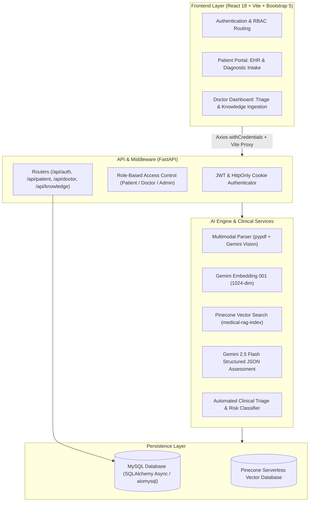
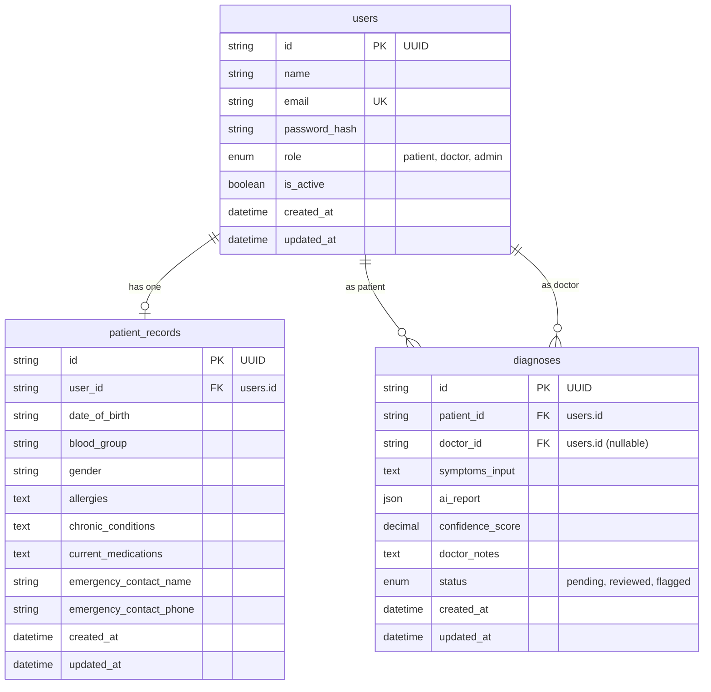

<div align="center">

# 🩺 MedIntel AI — Clinical Decision Support & Diagnostic RAG SaaS

**An enterprise-grade, full-stack Clinical Decision Support System (CDSS) powered by Google Gemini 2.5 Flash, Pinecone Vector Search, FastAPI, and React.**

[](https://fastapi.tiangolo.com/)
[](https://www.python.org/)
[](https://react.dev/)
[](https://vitejs.dev/)
[](https://ai.google.dev/)
[](https://www.pinecone.io/)
[](https://www.mysql.com/)

[Key Features](#-key-features) • [System Architecture](#-system-architecture) • [Tech Stack](#-tech-stack) • [Installation Guide](#-installation--setup) • [API Documentation](#-api-endpoints) • [Database Schema](#-database-schema)

</div>

---

## 📌 Overview

**MedIntel AI** is a specialized clinical decision-support SaaS platform designed to assist healthcare systems by streamlining patient triage, automating preliminary diagnostic assessments, and augmenting physician evaluations with verifiable clinical knowledge.

By combining **Retrieval-Augmented Generation (RAG)** over clinical reference literature with **multimodal report analysis** (PDF reports and medical imaging), MedIntel AI ensures generated insights are cautious, structured, and anchored in verified medical guidelines.

> **Disclaimer**: *MedIntel AI is a clinical decision-support tool created for informational and assistive purposes. It does not replace professional medical judgment, clinical consultation, or definitive diagnoses by licensed healthcare practitioners.*

---

## ✨ Key Features

### 👤 For Patients
* **Interactive Electronic Health Profile**: Manage personal medical history, including blood type, date of birth, known allergies, chronic conditions, current medications, and emergency contacts.
* **AI-Assisted Symptom Evaluation**: Enter natural-language symptom descriptions or attach diagnostic documents (lab reports, scans, discharge summaries).
* **Multimodal Report Extraction**: Automated text extraction from PDF lab reports and vision-based analysis of medical images (JPG/PNG).
* **Structured Clinical Assessments**: Receive structured reports with differential diagnoses, probability ratings, recommended confirmatory tests, red flags, and non-prescriptive lifestyle guidance.
* **Historical Longitudinal Record**: Review past assessments with live status badges (`PENDING`, `REVIEWED`, `⚠️ FLAGGED`) and physician review notes.

### 👨‍⚕️ For Doctors & Clinicians
* **Real-Time Triage Dashboard**: Overview of all registered patients with real-time indicators for records requiring physician review.
* **Urgency & Red-Flag Queue**: Automated risk triage that categorizes and highlights urgent cases requiring immediate doctor intervention.
* **Physician Review & Attestation**: Review AI-generated differentials against patient EHR data, record clinical review notes, and update case statuses.
* **RAG Knowledge Base Ingestion**: Directly upload authoritative clinical reference guidelines and clinical manuals in PDF format to expand the knowledge base.

---

## 🏗️ System Architecture



---

## 🛠️ Tech Stack

| Domain | Technologies |
|---|---|
| **Frontend** | React 18, Vite 5, React Router v7, Bootstrap 5, Axios |
| **Backend** | Python 3.10+, FastAPI, Uvicorn, Pydantic v2, SQLAlchemy 2.0 (Async) |
| **Generative AI** | Google GenAI SDK (`google-genai`), Gemini 2.5 Flash (`gemini-2.5-flash`) |
| **Embeddings & Vector Search** | Gemini Embeddings (`gemini-embedding-001`), Pinecone Vector Database |
| **Document Processing** | `pypdf`, `langchain-text-splitters` (`RecursiveCharacterTextSplitter`) |
| **Relational Database** | MySQL 8.0+ with `aiomysql` connection pooling |
| **Authentication & Security** | JWT (`PyJWT`), `bcrypt` (12 rounds), HttpOnly Strict SameSite Cookies |

---

## 🚀 Installation & Setup

### Prerequisites
* **Python 3.10+**
* **Node.js 18+ & npm**
* **MySQL 8.0+**
* **Google Gemini API Key** ([Get Gemini API Key](https://aistudio.google.com/))
* **Pinecone API Key & Index** ([Get Pinecone Key](https://www.pinecone.io/))

---

### 1. Database Setup (MySQL)

Create the database and schema using the provided [`schema.sql`](medical-ai-backend-fastapi/schema.sql):

```bash
mysql -u root -p < medical-ai-backend-fastapi/schema.sql
```

---

### 2. Backend Setup (FastAPI)

1. Navigate to the backend directory:
   ```bash
   cd medical-ai-backend-fastapi
   ```

2. Create and activate a Python virtual environment:
   ```bash
   # Windows PowerShell
   python -m venv venv
   .\venv\Scripts\Activate.ps1

   # Linux / macOS
   python3 -m venv venv
   source venv/bin/activate
   ```

3. Install backend dependencies:
   ```bash
   pip install -r requirements.txt
   ```

4. Configure environment variables:
   Copy `.env.example` to `.env` and fill in your credentials:
   ```bash
   cp .env.example .env
   ```
   *Update your MySQL credentials, `GEMINI_API_KEY`, and `PINECONE_API_KEY` in `.env`.*

5. Run the FastAPI development server:
   ```bash
   uvicorn main:app --reload --port 5000
   ```
   * Backend API: `http://localhost:5000`
   * Interactive OpenAPI Docs: `http://localhost:5000/docs`

---

### 3. Frontend Setup (React + Vite)

1. Open a new terminal and navigate to the frontend directory:
   ```bash
   cd medical-ai-frontend
   ```

2. Install dependencies:
   ```bash
   npm install
   ```

3. Start the Vite development server:
   ```bash
   npm run dev
   ```
   * Web Portal: `http://localhost:5173`

---

## 🔒 Environment Variables

### Backend Configuration (`medical-ai-backend-fastapi/.env`)

```ini
PORT=5000
NODE_ENV=development
CLIENT_URL=http://localhost:5173

# MySQL Configuration
DB_HOST=localhost
DB_PORT=3306
DB_USER=root
DB_PASSWORD=your_mysql_password
DB_NAME=medical_ai

# JWT Security
JWT_SECRET=your_super_secret_jwt_key_here

# File Upload Configuration
MAX_FILE_SIZE_MB=10
ALLOWED_FILE_TYPES=application/pdf

# Google Gemini API
GEMINI_API_KEY=your_gemini_api_key_here

# Pinecone Vector Database
PINECONE_API_KEY=your_pinecone_api_key_here
PINECONE_INDEX_NAME=medical-rag-index
EMBEDDING_DIMENSION=1024
```

---

## 📡 API Endpoints

### 🔐 Authentication (`/api/auth`)
| Method | Endpoint | Access | Description |
|---|---|---|---|
| `POST` | `/api/auth/register` | Public | Register a new patient or doctor account |
| `POST` | `/api/auth/login` | Public | Authenticate user & issue HttpOnly JWT cookie |
| `POST` | `/api/auth/logout` | Authenticated | Invalidate authentication session cookie |
| `GET` | `/api/auth/me` | Authenticated | Retrieve current authenticated user profile |

### 🩺 Patient Portal (`/api/patient`)
| Method | Endpoint | Access | Description |
|---|---|---|---|
| `GET` | `/api/patient/profile` | Patient | Retrieve patient electronic health record |
| `PUT` | `/api/patient/profile` | Patient | Update medical record (allergies, meds, etc.) |
| `GET` | `/api/patient/diagnoses` | Patient | Get longitudinal diagnostic history |
| `GET` | `/api/patient/diagnoses/{id}` | Patient | Get detailed single diagnosis assessment |
| `POST` | `/api/patient/diagnoses` | Patient | Submit symptoms & optional medical reports |

### 👨‍⚕️ Doctor Dashboard (`/api/doctor`)
| Method | Endpoint | Access | Description |
|---|---|---|---|
| `GET` | `/api/doctor/patients` | Doctor/Admin | Fetch all registered patients & review statuses |
| `GET` | `/api/doctor/patients/{id}/records` | Doctor/Admin | Comprehensive medical records & patient stats |
| `GET` | `/api/doctor/diagnoses/pending` | Doctor/Admin | Queue of pending/flagged diagnoses |
| `PUT` | `/api/doctor/diagnoses/{id}/review` | Doctor/Admin | Submit doctor clinical notes & update status |

### 📚 Knowledge Base (`/api/knowledge`)
| Method | Endpoint | Access | Description |
|---|---|---|---|
| `POST` | `/api/knowledge/ingest-pdf` | Doctor/Admin | Ingest clinical PDF guidelines into Pinecone RAG |

---

## 🗄️ Database Schema



---

## 🧠 Diagnostic RAG & Triage Flow

1. **Document Ingestion**:
   Medical textbooks or guidelines uploaded by physicians are split into semantic chunks (`chunk_size=1500`, `chunk_overlap=150`) using LangChain's `RecursiveCharacterTextSplitter`. Text chunks are embedded into 1024-dimension vectors via `gemini-embedding-001` and synced to Pinecone.
2. **Clinical Input & Extraction**:
   Patients submit subjective symptoms and optionally attach medical records. Text from PDFs is extracted using `pypdf`, while report images (e.g., blood work, pathology scans) are interpreted by `gemini-2.5-flash` vision capabilities.
3. **Similarity Search**:
   The query vector retrieves the top-5 most relevant reference snippets from Pinecone.
4. **Constrained Clinical Reasoning**:
   Gemini receives the patient's EHR profile, reported symptoms, extracted lab findings, and retrieved literature chunks. It returns a structured JSON payload adhering to strict clinical validation schemas.
5. **Intelligent Triage**:
   The triage system automatically classifies urgency. Critical symptoms and detected red flags trigger an immediate `flagged` status, prioritizing the patient in the clinician's review queue.

---

## 🛡️ Security & Privacy Features

* **HttpOnly JWT Session Storage**: Authentication tokens are stored exclusively in HttpOnly cookies with `SameSite=Strict`, mitigating Cross-Site Scripting (XSS) and token theft risks.
* **Role-Based Access Control (RBAC)**: Fine-grained access enforcement prevents unauthorized role privilege escalation between patient and doctor endpoints.
* **Input Sanitization & Validation**: Strong Pydantic v2 schemas validate all incoming payloads, request bodies, and query parameters.
* **Non-Prescriptive Safe Prompting**: The AI model is strictly conditioned to refrain from generating unsupervised prescriptions or speculative diagnoses without confirmatory lab testing.

---

## 📄 License

This project is licensed under the [MIT License](LICENSE).
